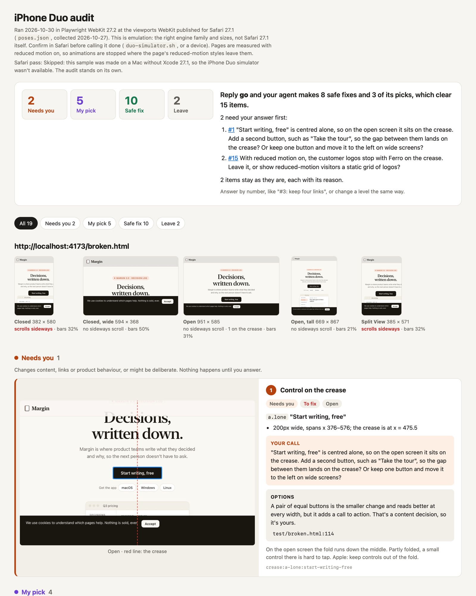

# fit-iphone-duo

Make your website work on iPhone Duo. Your coding agent audits the site at the five sizes Safari 27.1 really gives a page, fixes what breaks in your own code, and shows you the before and after.

It's for websites and web apps. Native iOS apps get Apple's own APIs and need a different skill.

**[Try your site in the playground first →](https://marigameo.github.io/iphone-duo-playground/)** It shows your site at the same sizes, with Safari's bars and the crease drawn in.

## Install

```bash
npx skills@latest add marigameo/skills
```

Then ask your coding agent to "make my site work on iPhone Duo". It starts at [SKILL.md](SKILL.md). You get `duo-report/duo-report.html`: every finding with a picture where there's something to see, sorted into what needs your answer, what the agent will pick, what's a safe fix and what to leave. Reply "go" and the agent makes the safe fixes and its picks; it waits for your answers on the rest. The audit needs Playwright with WebKit (`npm i -D playwright && npx playwright install webkit`). The Safari check at the end needs Xcode 27.1 on a Mac, and skips cleanly without it.

## What the report looks like

**[Open the sample report →](https://marigameo.github.io/iphone-duo-playground/report/)** It covers two pages of the test site: the plan at the top, the levels, the five poses, then a card per item with the crease drawn and the element outlined.

[](https://marigameo.github.io/iphone-duo-playground/report/)

Its source, with the triage and how to make it again, is in [`sample-report/`](sample-report/).

## What's inside

| File | What it covers |
|---|---|
| [SKILL.md](SKILL.md) | The facts, the rules, the sequence, and a done checklist |
| [CHECKS.md](CHECKS.md) | What the audit measures, its thresholds and where each comes from |
| [FIXES.md](FIXES.md) | A fix at the cause for every finding, with code |
| `duo-audit.mjs` | The audit: WebKit, five poses, the crease, the CSS, and behaviour when the page resizes |
| `duo-report.mjs` | The report you read: a card per item with an annotated screenshot, sorted into Needs you, My pick, Safe fix and Leave, and a plan that says what "go" will do |
| `duo-simulator.sh` | An optional last look in real Safari on Xcode's iPhone Duo simulator |
| `poses.json` | The viewport numbers, shared with the playground |
| `test/` | Margin, a made-up writing app: its home page with every problem planted, the same page fixed, and its customers page of judgement calls. The self-test proves every check catches what it should, at the right level, and that the report shows every item |
| [`sample-report/`](sample-report/) | The report for the test site, triaged, and how to make it again |

## What it catches

Sideways scroll. Buttons and links on the crease of the open screen. Sticky headers, banners and chat bubbles that bury a 368px-tall screen. Layouts read once at load, or from the user agent or `screen.width`, that stay wrong after the device opens. `vh` heights, hover-only menus, safe areas and the background colour Safari paints behind its bars.
